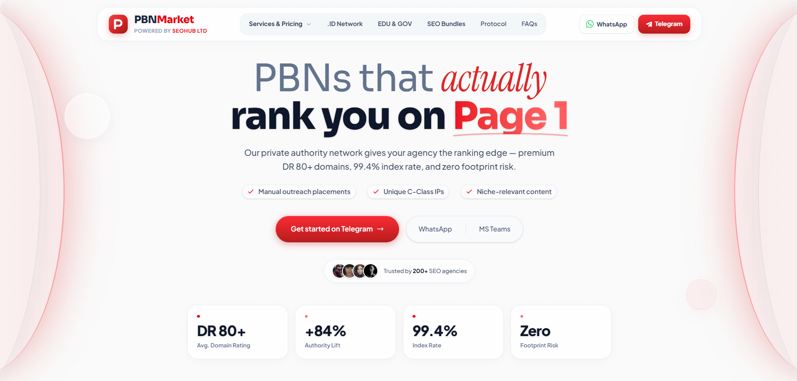

# PBNMarket – Enterprise SEO Infrastructure

> **CONFIDENTIALITY & PORTFOLIO NOTICE:**
> This repository contains proprietary front-end architecture and UI/UX components developed for **SeoHub Ltd**. It is showcased here strictly for **portfolio demonstration purposes** by [Rafay - Lead Frontend/UI Engineer]. Unauthorized copying, distribution, cloning, or commercial use of this codebase is strictly prohibited.

## Project Overview
**PBNMarket** is a premium, high-performance SaaS landing page and service marketplace. It provides global SEO agencies and enterprise brands with a self-serve portal to configure and purchase high-authority (DA/DR 50+) backlink packages across `.COM`, `.ID`, `.EDU`, and `.GOV` networks.

The UI/UX is engineered to mirror top-tier tech standards (inspired by Vercel and Stripe), featuring fluid typography, glassmorphism, a zero-pure-black color aesthetic, and flawless micro-interactions.

## Engineering & UI/UX Highlights
- **Smart Deep-Linking & Auto-Scroll:** Custom event dispatchers (`navigateToService`) allow flawless cross-component navigation. Clicking a service from the Header or Footer automatically scrolls to the exact card, waits for Framer Motion to mount, and applies a target-lock glow.
- **Dynamic SaaS Pricing Engine:** A highly interactive service catalog with traffic tiers, custom quantity inputs, and real-time total calculations.
- **Automated Order Dispatch:** Auto-generates detailed invoice-style order messages and routes them directly to Telegram and WhatsApp sales desks via dynamic URLs.
- **Ultra-Premium Aesthetic:** Implements a strict "no pure black" color palette, utilizing rich slate tones (`rgba(15,23,42)` shadows) and signature crimson accents.
- **Fluid Responsive Typography:** Implements CSS `clamp()` functions for pixel-perfect font scaling across all screen sizes (mobile to 4K).
- **Accessibility & Reduced Motion:** Full `focus-visible` keyboard navigation support and respects user accessibility preferences by disabling heavy ambient animations when `prefers-reduced-motion` is active.

## Tech Stack
- **Core Framework:** React 18 (Vite)
- **Styling Engine:** Tailwind CSS (v3)
- **Animations:** Framer Motion
- **Icons:** Lucide React
- **Typography:** Sora (Headings), Instrument Serif (Accents), Inter (Body)

## Core Component Architecture
- `Header.jsx`: Deep-linked mega menu with an app-style mobile drawer and Smart Target Seeker navigation.
- `Hero.jsx`: High-conversion entry point with ambient background glows, floating glass orbs, and animated data counters.
- `About.jsx`: Bento-box style corporate profile and interactive vertical history timeline.
- `Services.jsx`: The core engine—a sticky-nav tabbed interface with Framer Motion layout transitions and built-in auto-retry scroll logic.
- `Footer.jsx`: Semantic SEO-optimized footer with direct deep-links to specific catalog cards.

---
**© 2026 SeoHub Ltd. All Rights Reserved.**  
*Architecture and Frontend Design by **Rafay**.*
